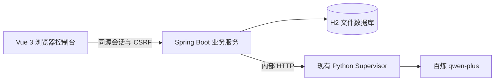

# 架构与上线边界

## 职责

Vue：表单、结果展示、状态筛选与查询；不存储模型凭据。

Java：身份认证、访问控制、参数校验、并发保护、请求追踪、结果持久化和操作审计。

Python：用户画像、商品召回 / 排序、库存判断和文案生成。保留已有 LangGraph / Supervisor 示例实现。原项目的商品和库存是演示数据，不能作为真实交易库存。

## 当前范围

前端和业务服务使用 Java + Vue；AI Agent 没有迁移为 Java，也没有依赖原 `java/` 示例中的 Spring AI 配置。这个选择复用已验证的百炼连接，降低重写风险。

审计为数据库记录，不是防篡改审计系统；目前单管理员、单实例。H2 适合本地演示，不是生产多副本共享数据库。请求历史含用户编号和偏好，上线需定义数据保留与清理规则。

## 生产环境后续建设

1. 业务真实性：接入商品中心、订单与用户行为、库存服务；替换示例召回数据；定义超卖防护。
2. 权限与账号：用户管理、运营 / 管理员 RBAC、密码轮换、登录限流和组织隔离。
3. 数据与任务：迁移 PostgreSQL / MySQL，使用 Flyway 管理版本；推荐任务异步化，队列和可取消任务；审计归档与保留策略。
4. 运维与质量：HTTPS、密钥管理、备份恢复演练、监控告警、链路追踪、CI/CD、依赖安全更新、压力测试和模型质量评估。
5. AI 可靠性：强制结构化输出、Prompt 版本、成本预算、模型级超时与熔断、数据脱敏；当前 Python 基类并未落实所有 README 描述的能力。

不能把界面美化、启用 Spring Boot 或增加 Docker 等同于已达到生产级可靠性。当前版本交付的是具备安全与持久化基础的端到端工作台。
